# Upscale Trade — практическая методичка

Пошаговые инструкции для первого знакомства с мобильным терминалом. Каждый раздел можно читать отдельно; бот для работы с методичкой не нужен.

Редакция: 25 октября 2026 года.

> Все иллюстрации показывают настоящий интерфейс и учебные операции на демо-счёте. Значения относятся ко времени съёмки, отличаются между примерами и не являются текущими торговыми сигналами. Красные рамки выделяют нужные кнопки и поля.

> Перед использованием реальных сигналов уточните их допустимость: Upscale запрещает систематическое копирование сделок другого трейдера Upscale, включая сигнальные сервисы. Самостоятельный ввод заявки не отменяет этого правила. До уточнения условий практикуйтесь на демо.

## Содержание

1. [[#1. Начало работы и выбор счёта]]
2. [[#2. Как читать торговый сигнал]]
3. [[#3. Как открыть LONG]]
4. [[#4. Как открыть SHORT]]
5. [[#5. Как рассчитать залог и риск]]
6. [[#6. Как поставить Stop Loss и Take Profit]]
7. [[#7. Как изменить стоп или тейк]]
8. [[#8. Limit: создание, изменение и отмена]]
9. [[#9. Как закрыть часть или всю позицию]]
10. [[#10. Счета и ограничения]]
11. [[#11. Проверка перед подтверждением]]

---

## 1. Начало работы и выбор счёта

1️⃣ Откройте https://app.upscale.trade и войдите в свой аккаунт.

2️⃣ Внизу экрана выберите «Счета». Откройте «Демо-счет 10K». Перед тренировкой убедитесь, что видите слово «Демо».

3️⃣ Посмотрите торговый баланс и стоп-уровни. На карточке счёта также отображаются результат и прогресс челленджа. Именно здесь проверяют, сколько осталось до нарушения ограничений.

4️⃣ Для поиска монеты откройте «Торговля». Для контроля позиций, заявок и истории используйте «Портфель» или вкладки в карточке монеты.

ЧТО ОЗНАЧАЮТ СУММЫ

Номинал проп-счёта — предоставленный платформой торговый размер по её правилам. Счёт 10 000 USD не означает, что вы внесли 10 000 своих денег или можете вывести весь номинал.

Текущий баланс/equity отражает результат счёта, включая открытые позиции. Свободный баланс показывает, сколько доступно для новых заявок. Эти значения могут отличаться.

Сумма участия в платном челлендже — отдельная величина. Для освоения интерфейса покупать челлендж не требуется.

✅ Перед любым действием проверяйте выбранный счёт. Если его название не видно, вернитесь в «Счета» и выберите нужный.

### Скриншоты к разделу

**Рисунок 1. Выберите демо-счёт. Проверьте баланс и стоп-уровень.**

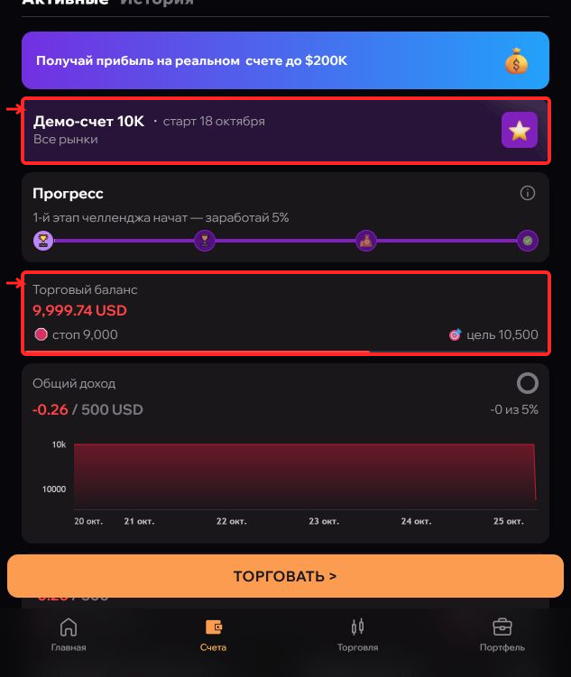

---

## 2. Как читать торговый сигнал

Учебный пример, не текущая рекомендация:

BTC LONG — ОТКРЫТЬ
Сигнал №104 · АКТУАЛЕН
Вход: 50 000 USD
Тип: MARKET при подтверждённой подходящей цене
Stop Loss: 49 000
Take Profit: 52 000
Планируемый риск: 1% выбранной базы счёта

У настоящего сообщения должны быть дата, срок актуальности и понятный источник. Пример выше предназначен только для объяснения полей.

• BTC — монета, которую нужно найти.
• LONG — направление на рост; SHORT — на снижение.
• Вход — предполагаемая цена открытия.
• Stop Loss, или SL, — уровень защитного закрытия.
• Take Profit, или TP, — уровень фиксации прибыли.
• Market — вход по текущей доступной цене.
• Limit — заявка, ожидающая заданный уровень.

Риск 1% — расчётный убыток от выбранной базы при стопе. Это не доля залога и не обещание максимального убытка.

КАК РЕАГИРОВАТЬ НА ОБНОВЛЕНИЯ

«Изменён SL» → измените стоп существующей позиции, а не открывайте ещё одну.
«Изменён TP» → измените тейк нужной позиции.
«Отменён» → новый вход по этому сигналу не выполняйте.
«Закрыт» → проверьте свою позицию: состояние автора может отличаться от вашего.

Если цена уже заметно ушла от входа, не открывайте Market автоматически. Уточните актуальность и пересчитайте риск. Если данных не хватает, сначала уточните их у автора.

Если сделка уже закрылась по SL или TP, обновление не означает, что её нужно открыть заново.

---

## 3. Как открыть LONG

Практикуйтесь на демо. Для своего сигнала используйте его подтверждённые данные; цифры на фотографиях — учебные.

1️⃣ Выберите нужный счёт в «Счета». Откройте «Торговля», введите BTC в поиск и нажмите строку BTC USD. Проверьте тикер и валюту пары целиком.

2️⃣ В карточке монеты нажмите LONG. В форме должна быть выбрана вкладка Long, подсвеченная зелёным. Читайте надпись, не ориентируйтесь только на цвет.

3️⃣ Выберите Market или Limit согласно сигналу. Для Limit отдельно укажите цену входа. Не заменяйте Limit на Market по привычке.

4️⃣ Проверьте режим ввода. «На сумму» — сумма в USD; режим объёма — количество монет. Не вводите размер позиции в поле залога и USD в поле BTC.

5️⃣ Укажите рассчитанную сумму и разрешённое плечо. Расчёт — в уроке #upscale_risk. В режиме «На сумму» комиссия может уменьшить фактическую маржу: сверяйте предварительный объём внизу формы.

6️⃣ В Stop Loss введите цену стопа, в Take Profit — цену тейка. Для обычного начального LONG стоп ниже входа, тейк выше.

7️⃣ Перепроверьте счёт, монету, направление, тип входа, сумму, плечо, SL/TP, комиссию и примерную цену ликвидации. Ликвидация не должна наступать раньше выбранного защитного стопа.

8️⃣ Только после проверки нажмите нижнюю кнопку LONG. Дождитесь обработки заявки.

9️⃣ Откройте «Позиции». Проверьте фактический вход, объём и отметки SL/TP. Для ожидающего Limit сначала проверьте «Ордера»: заявка ещё не означает открытую позицию.

Учебный пример до издержек: вход 50 000, SL 49 000, TP 52 000; база 10 000 и риск 1% → объём 5 000 USD, залог 1 000 при x5. SL ≈ −100, TP ≈ +200 USD.

На фото проверялась другая учебная сделка с суммой 20 USD и x2. Не смешивайте её уровни с примером 50 000.

⚠️ При задержке не нажимайте повторно: сначала проверьте «Позиции», «Ордера» и уведомления.

### Скриншоты к разделу

**Рисунок 2. Введите BTC в поиск, затем выберите строку BTC USD.**

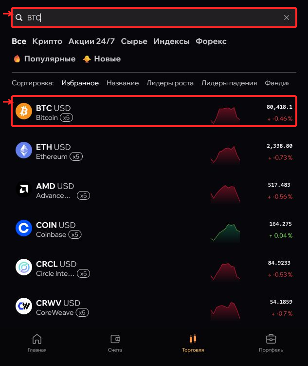

**Рисунок 3. Проверьте LONG или SHORT по надписи. Ниже находится список позиций.**

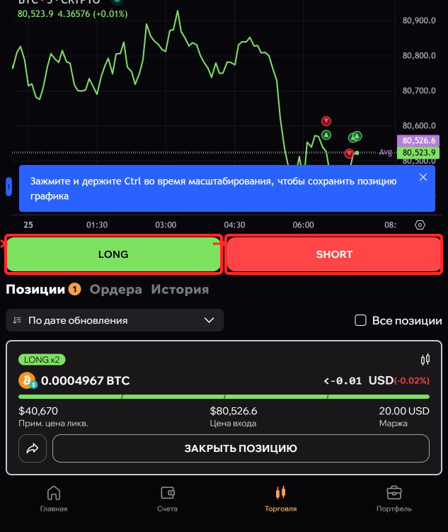

**Рисунок 4. Market, режим На сумму: учебная сумма 20 USD и плечо x2. Точный размер смотрите в расчёте терминала.**

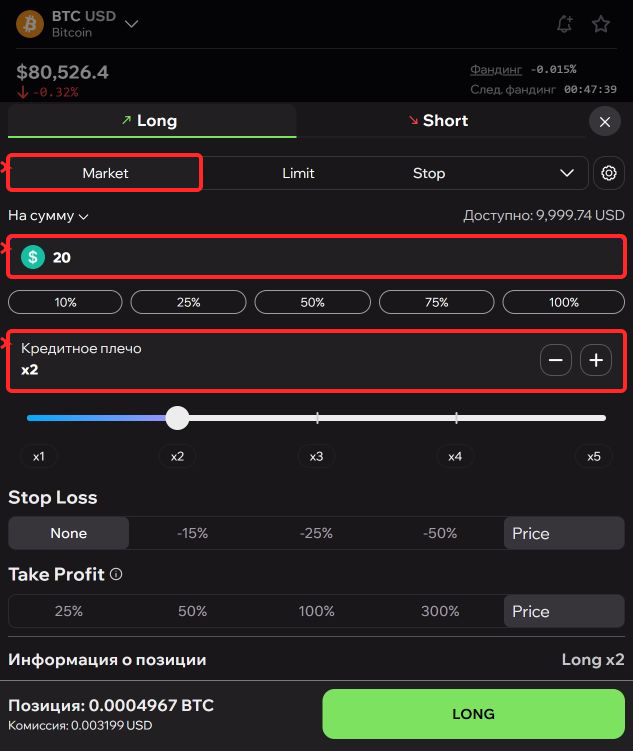

**Рисунок 5. Учебный LONG: x2, SL 79000, TP 83000. Эти цены относятся к демо-проверке.**

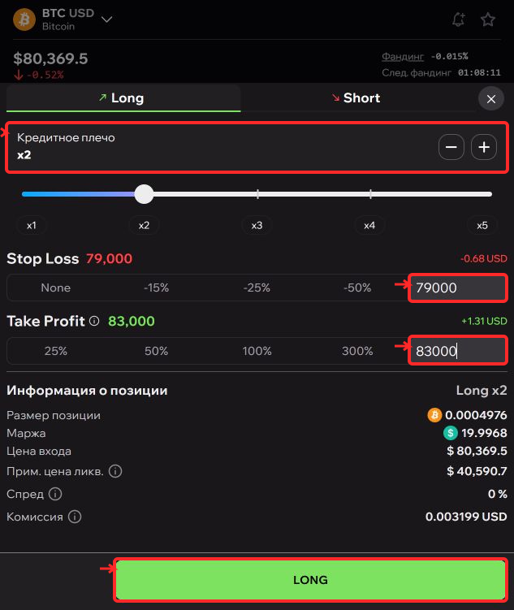

**Рисунок 6. Проверьте открытую позицию, её объём и отметки SL/TP.**

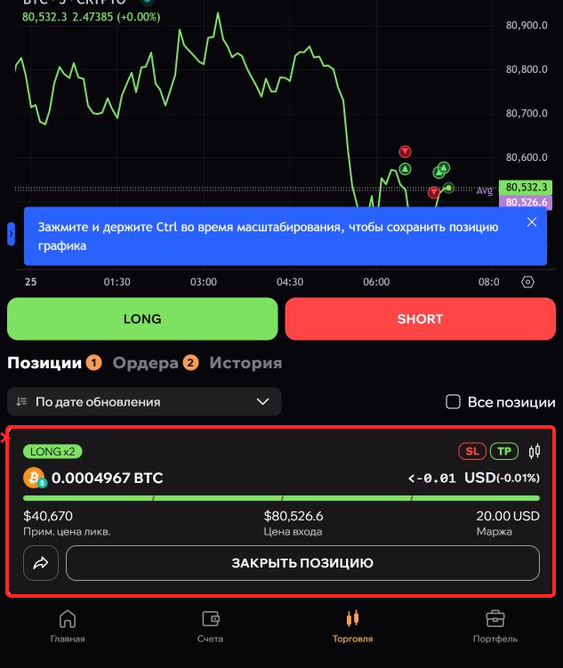

---

## 4. Как открыть SHORT

SHORT — направление на снижение цены. Для него расположение защитных уровней противоположно LONG.

1️⃣ Выберите демо-счёт → «Торговля» → нужную монету.

2️⃣ Нажмите SHORT. В форме должна быть выбрана вкладка Short, подсвеченная красным.

3️⃣ Выберите Market или Limit по сигналу. Для Limit заполните цену входа.

4️⃣ Выберите режим суммы или объёма. Введите рассчитанные значения и разрешённое плечо. Проверьте единицу поля: USD и BTC — разные величины.

5️⃣ Для обычного начального SHORT задайте Stop Loss ВЫШЕ цены входа, а Take Profit НИЖЕ.

6️⃣ Проверьте предварительную информацию: направление Short, объём, маржу, комиссию и цену ликвидации. После проверки нажмите нижнюю кнопку SHORT.

7️⃣ Дождитесь исполнения. В «Позиции» проверьте, что открыт именно SHORT нужной монеты и установлены защитные ордера.

УЧЕБНЫЙ ПРИМЕР ДО ИЗДЕРЖЕК

Вход: 50 000 USD
SL: 51 000
TP: 48 000
База риска: 10 000 USD
Риск: 1% = 100 USD
При x5: залог 1 000, объём 5 000 USD.
Движение до SL: около −100 USD.
Движение до TP: около +200 USD.

На фотографиях проверялся другой SHORT: вход около 80 467,6, SL 82 000, TP 79 000, сумма 20 USD и x2. Эти цены не являются действующим сигналом.

Не открывайте SHORT для закрытия LONG. Закрывайте существующую позицию через её кнопку «Закрыть позицию» — урок #upscale_close.

### Скриншоты к разделу

**Рисунок 7. Учебный SHORT: x2, SL 82000 выше входа, TP 79000 ниже входа.**

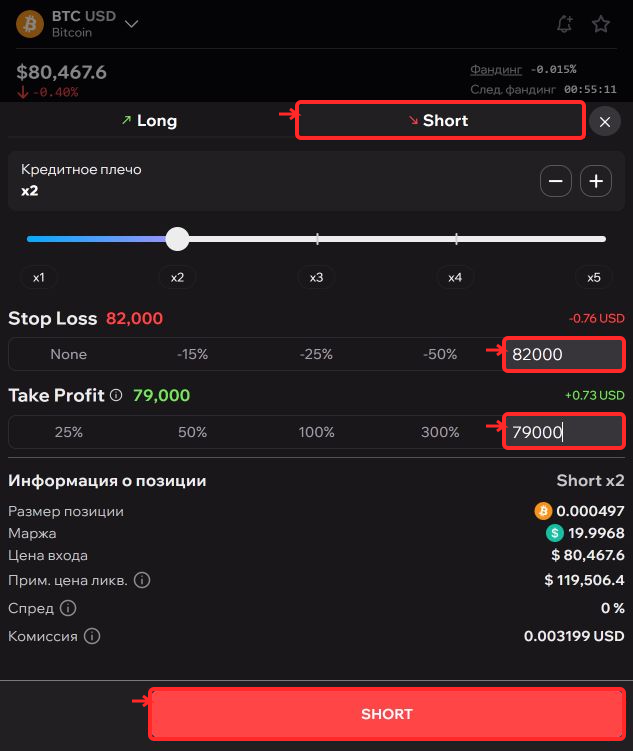

**Рисунок 8. Подтвердите SHORT и объём в открытой позиции. Закрытие — отдельная кнопка.**

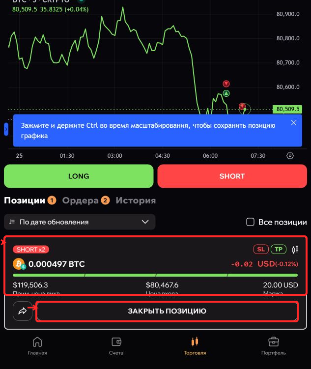

---

## 5. Как рассчитать залог и риск
комент от разраба: вот тут надо четко рассказать что вписываем стоп тейк, и после этого депом и плечом регулируем потерю по стопу в нужный процент
слишком много воды налил

Сначала выберите базу: стартовый номинал или актуальную equity. Всегда называйте её явно. «1%» без указания базы — неполный расчёт.

Разберём условный BTC LONG: вход 50 000, SL 49 000, TP 52 000.

1️⃣ Расстояние до стопа: (50 000 − 49 000) ÷ 50 000 = 2%.

2️⃣ Для базы 10 000 USD риск 1% даёт бюджет 100 USD.

3️⃣ До издержек объём позиции: 100 ÷ 0,02 = 5 000 USD. При x5 залог: 5 000 ÷ 5 = 1 000 USD.

У SHORT расстояние до стопа считается так же — берётся положительная разница между входом и SL.

ТРИ ВАРИАНТА

• Риск 1%, x5 → залог 1 000; объём 5 000; убыток по движению до SL ≈ 100 USD.
• Риск 0,5%, x5 → залог 500; объём 2 500; убыток ≈ 50 USD.
• Залог 1 000, x2 → объём 2 000; убыток ≈ 40 USD, или 0,4% базы.

Все три примера — без издержек. При неизменном объёме само уменьшение плеча не уменьшает убыток от того же движения цены: потребуется больше залога.

КАК УЧЕСТЬ РАСХОДЫ

Заложите запас на комиссии открытия/закрытия, спред, исполнение и фандинг. Например, если из бюджета 100 USD заранее выделить 10 USD на расходы, на движение до стопа остаётся 90 USD: объём 4 500, залог 900 при x5.

10 USD здесь — условный запас, а не тариф Upscale и не гарантия достаточности. Проверьте предварительные расходы в терминале. В режиме «На сумму» фактическая маржа может быть меньше введённой суммы.

ПЕРЕД ВХОДОМ

✅ Хватает свободного баланса с резервами?
✅ Плечо разрешено? Crypto: Basic/Accelerated до x5, Turbo до x2.
✅ Суммарный риск всех позиций и ожидающих входов меньше оставшегося запаса просадки?
✅ Стоп расположен до уровня ликвидации?

Не считайте запас просадки от номинала наугад: сверяйте текущие стоп-уровни счёта. Для Turbo общий предел динамический.

Расчётный убыток не является гарантированным максимумом. Комиссии, исполнение, ликвидация и другие позиции могут изменить результат.

---

## 6. Как поставить Stop Loss и Take Profit

ПРИ ОТКРЫТИИ

1️⃣ Введите сумму сделки в форме LONG/SHORT.
2️⃣ В строке Stop Loss укажите цену защитного закрытия.
3️⃣ В строке Take Profit укажите цену фиксации прибыли.
4️⃣ Используйте поля цены справа от процентных пресетов. Процентный пресет может относиться к результату позиции и не совпадать с процентом движения цены.
5️⃣ После отправки проверьте SL/TP в «Позиции» и связанные ордера в «Ордера».

Для обычного начального LONG: SL ниже входа, TP выше. Для SHORT: SL выше входа, TP ниже.

ЕСЛИ ПОЗИЦИЯ УЖЕ ОТКРЫТА

1️⃣ В карточке нужной монеты откройте «Ордера» → «Создать ордер».
2️⃣ В выпадающем списке выберите Stop Loss либо Take Profit. Проверьте направление и соответствие своей позиции.
3️⃣ В верхнем поле со значком доллара введите ЦЕНУ срабатывания.
4️⃣ Нижнее поле со значком монеты задаёт ОБЪЁМ защиты. Для всего текущего остатка нажмите 100% под этим полем.
5️⃣ Проверьте цену, объём и примерный результат. Нажмите «Создать».
6️⃣ Убедитесь, что защитный ордер появился в активном списке. Второй уровень добавляется отдельно.

⚠️ Не вводите цену 79 000 в поле количества BTC. Не копируйте округлённый объём из карточки: он может чуть превышать точный остаток. Для полного объёма используйте кнопку 100%.

Если терминал отклонил значения, прочитайте ошибку и исправьте её. Защита установлена только после успешного сохранения, а не после появления числа в поле.

На снимках — учебные уровни. Переносите цены своего подтверждённого сигнала.

### Скриншоты к разделу

**Рисунок 9. Поздняя защита: выберите Stop Loss, цену 79000 и 100% фактического объёма. Затем Создать.**

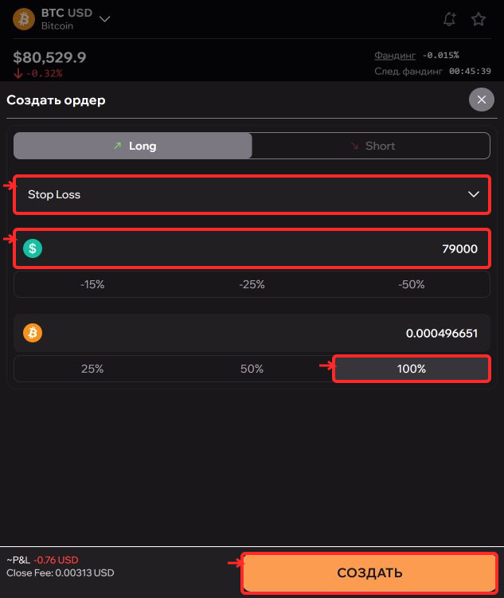

**Рисунок 10. В карточке нужного защитного ордера нажмите ИЗМЕНИТЬ. Не путайте с отменой.**

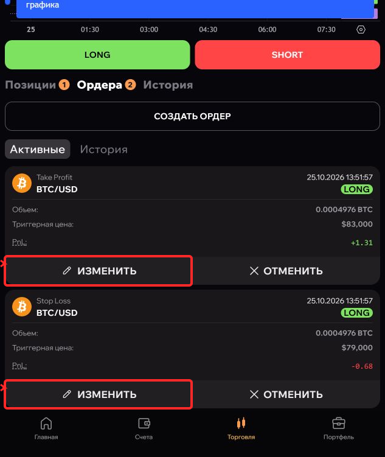

---

## 7. Как изменить стоп или тейк

Пример обновления: «BTC LONG — ИЗМЕНЁН. Новый SL 50 200. TP без изменений».

Это действие с существующей позицией, а не новый вход.

1️⃣ Найдите свою позицию. Сверьте монету, направление, вход и объём. Если позиций несколько, уточните, к какой относится обновление.

2️⃣ Откройте «Ордера». Найдите связанную карточку Stop Loss или Take Profit и нажмите «Изменить».

3️⃣ Измените верхнее поле ЦЕНЫ в USD. Нижнее поле ОБЪЁМА монеты без необходимости не меняйте.

4️⃣ Проверьте значения и нажмите «Сохранить».

5️⃣ Вернитесь в список ордеров и перечитайте сохранённую цену. Если обновлялся только SL, убедитесь, что TP остался прежним.

НОВЫЙ СТОП НЕ ВСЕГДА БЕЗОПАСНЕЕ

Стоп дальше от входа может увеличить убыток. Новый уровень за текущей ценой может быть отклонён или привести к немедленному исполнению. Сравните его с фактическим входом и текущим рынком, пересчитайте результат.

ЕСЛИ SL ИЛИ TP УЖЕ ИСПОЛНИЛСЯ

Откройте историю и проверьте закрытие. Не создавайте новый ордер для позиции, которой уже нет. После частичного закрытия управляйте только оставшимся объёмом.

Удаление защитного ордера снимает защиту, но не закрывает позицию. Нажимайте «Отменить» только тогда, когда действительно хотите удалить именно этот SL или TP.

### Скриншоты к разделу

**Рисунок 11. Stop Loss: верхнее поле — цена в USD, нижнее — объём BTC. Сохраните и перепроверьте.**

**Рисунок 12. Take Profit: измените цену в USD. Объём BTC проверьте отдельно.**

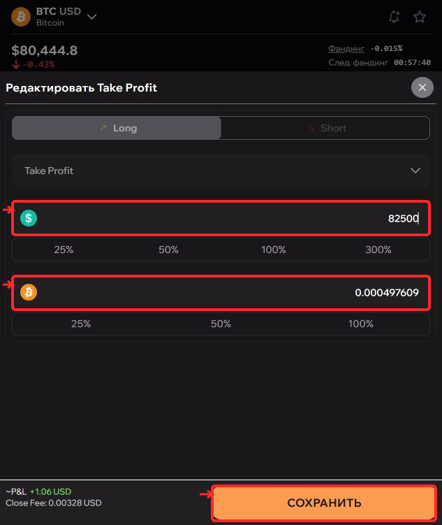

**Рисунок 13. Отменяйте только выбранный SL или TP. Отмена защитного ордера оставляет позицию открытой.**

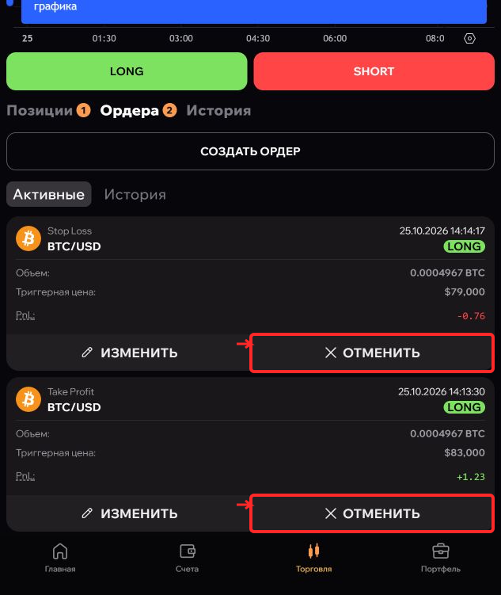

---

## 8. Limit: создание, изменение и отмена

Limit — ожидающий вход по заданному уровню. Отправленный ордер ещё не означает открытую позицию.

КАК СОЗДАТЬ

1️⃣ Откройте монету и выберите LONG или SHORT.
2️⃣ Переключитесь с Market на Limit.
3️⃣ В поле Limit введите цену входа по сигналу.
4️⃣ Заполните рассчитанную сумму, разрешённое плечо, SL и TP.
5️⃣ Проверьте всё и подтвердите заявку.
6️⃣ Откройте «Ордера»: проверьте монету, направление, цену и объём.

На снимках создан учебный LONG Limit: вход 70 000, сумма 20 USD, x2, SL 69 000, TP 72 000. Это не актуальный торговый сигнал.

КАК ИЗМЕНИТЬ ЦЕНУ

В проверенной мобильной карточке ожидающего Limit доступна только кнопка «Отменить». Прямое редактирование цены здесь не подтверждено.

Поэтому сначала отмените старую заявку и дождитесь подтверждения. Проверьте, что она не успела исполниться. Затем, если сигнал остаётся актуальным, создайте новую с нужной ценой и заново проверьте риск.

Не отправляйте замену, пока не убедились, что старой заявки больше нет.

КАК ОТМЕНИТЬ

В «Ордера» найдите именно Limit нужной монеты → «Отменить». Дождитесь обработки и убедитесь, что его больше нет среди активных.

Отмена ожидающего входа НЕ закрывает уже открытую позицию. Если заявка исполнилась, переходите в «Позиции» и управляйте результатом исполнения.

У SL/TP есть отдельная кнопка «Изменить». Их отмена удаляет защиту. Перед нажатием всегда читайте тип ордера.

Дополнительный вход может увеличить существующую позицию и изменить среднюю цену. Учитывайте общий риск, а не только риск новой заявки.

### Скриншоты к разделу

**Рисунок 14. Limit: цена 70000 USD, учебная сумма 20 USD, плечо x2. Перед отправкой добавьте SL/TP.**

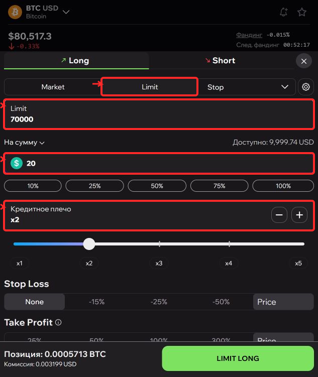

**Рисунок 15. Limit пока ожидает: проверьте цену и защиту. Здесь доступна отмена, а не редактирование цены.**

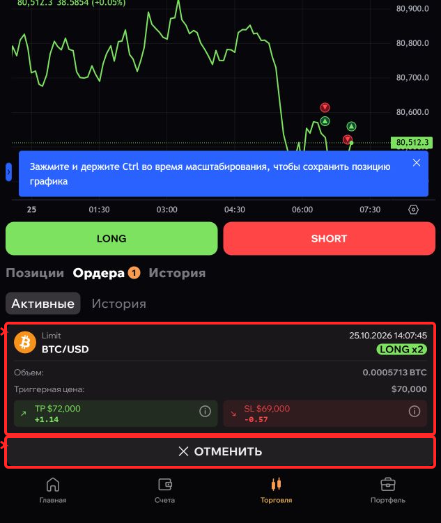

**Рисунок 16. После отмены список активных ордеров пуст. Отмена входа не закрывает открытую позицию.**

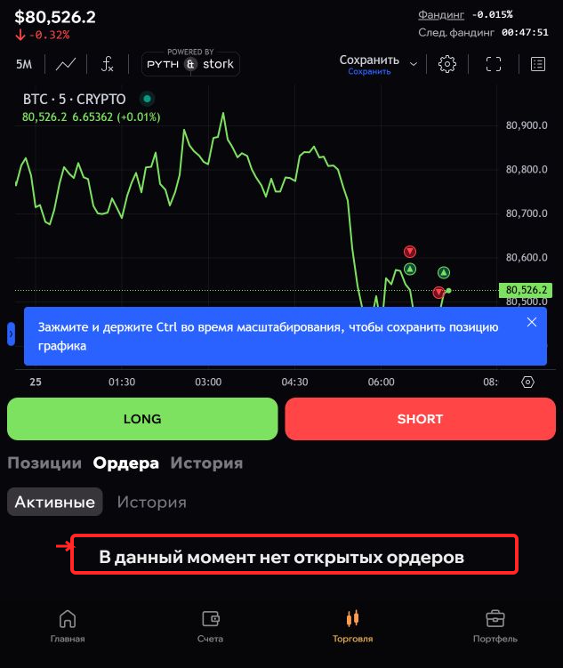

---

## 9. Как закрыть часть или всю позицию

КАК ЗАКРЫТЬ ПОЛОВИНУ

1️⃣ Откройте «Позиции». Сверьте монету, направление и текущий объём.
2️⃣ Нажмите «Закрыть позицию» в нужной карточке.
3️⃣ В форме выберите 50%.
4️⃣ Посмотрите блок «Новая позиция»: должен остаться примерно половинный объём.
5️⃣ Проверьте ожидаемую цену, комиссию и результат. Подтвердите.
6️⃣ После исполнения проверьте остаток и защитные ордера на него.

КАК ЗАКРЫТЬ ВСЁ

1️⃣ В форме закрытия выберите 100% текущего объёма.
2️⃣ В блоке «Новая позиция» должно быть 0 монет.
3️⃣ Подтвердите и дождитесь исполнения.
4️⃣ Убедитесь, что позиция исчезла из открытых.
5️⃣ Проверьте «Ордера»: отдельный ожидающий вход может открыть позицию снова.

После частичного закрытия 100% означает весь ОСТАВШИЙСЯ объём, а не первоначальную сумму.

ГДЕ ПОСМОТРЕТЬ ИТОГ

«История» → нужная закрытая сделка → «Подробнее».
Проверьте статус «Закрыта», цену входа и выхода, прибыль, комиссию и оплаченный фандинг. Учитывайте все расходы: результат до закрытия может отличаться от итогового.

ЕСЛИ ПРИШЛО «ЗАКРЫТЬ», А ПОЗИЦИИ НЕТ

Сначала проверьте историю — возможно, уже сработал SL или TP. Новую сделку не открывайте. Если осталось несколько позиций одной монеты, сопоставьте направление, вход и объём.

Не путайте уменьшение маржи с частичным закрытием: изменение залога само по себе не уменьшает размер позиции.

### Скриншоты к разделу

**Рисунок 17. 50% уменьшает позицию вдвое. Сверьте остаток в блоке Новая позиция.**

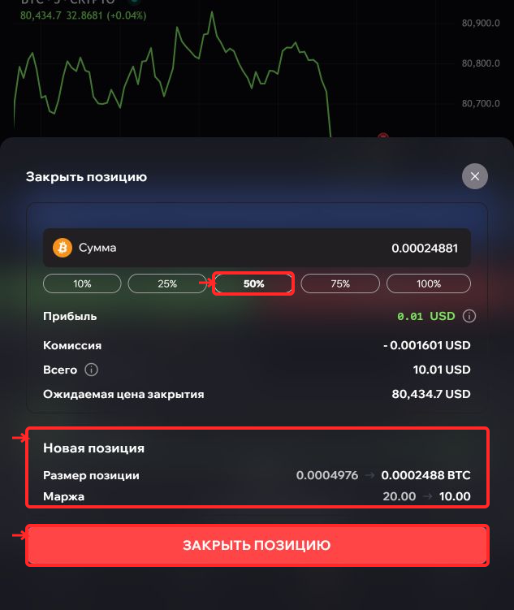

**Рисунок 18. 100% закрывает весь текущий остаток. Новая позиция должна стать 0 BTC.**

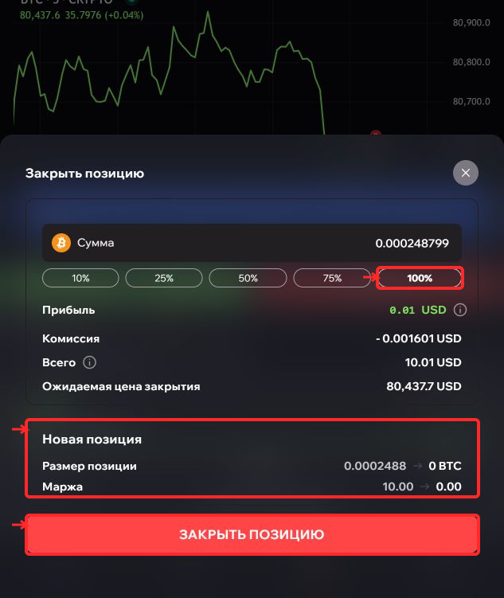

**Рисунок 19. История → Подробнее: статус Закрыта, цена входа/выхода, комиссия и фандинг проверяются отдельно.**

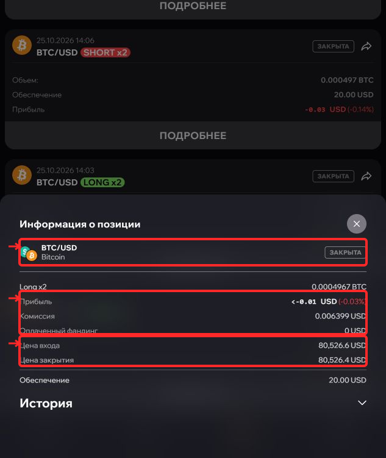

---

## 10. Счета и ограничения

Условия проверены по документации 25.10.2026. Перед торговлей сверяйте именно свой счёт: правила ранее приобретённых челленджей могут отличаться.

BASIC
• Два этапа: цели 5%, затем 8%.
• Профитные дни: 3, затем 5.
• Дневная просадка 5%, общая обычно 10%.
• Для новых Basic 200K на этапе 2 и funded общий лимит 8%.
• Плечо для криптовалют до x5.

ACCELERATED
• Один этап: цель 10%.
• Минимум 3 профитных дня.
• Дневная просадка 3%, общая 6%.
• Плечо для криптовалют до x5.

TURBO
• Сразу funded, без этапов оценки.
• Цель по прибыли не установлена; минимум 5 профитных дней.
• Дневного лимита нет, общий предел динамический: 6% от максимального баланса с учётом правил пересчёта.
• Плечо для криптовалют до x2.

После Basic/Accelerated на funded для вывода требуется 5 профитных дней. Профитный день — прирост не менее 0,5% начального баланса. Торговые сутки считаются по UTC.

Открытый убыток уже влияет на просадку: нарушение возможно до ручного закрытия. Проверяйте текущие стоп-уровни, а не только стартовый номинал.

Издержки включают комиссии, спред и фандинг. Для Crypto документация указывает фандинг 0,015% от объёма каждые 8 часов; актуальные значения проверяйте в терминале.

Если включён API Trading, действуют дополнительные правила всего счёта, в том числе для ручных операций. Для обучения API-ключи не нужны.

Официальные правила:
https://docs.upscale.trade/ru/kak-prisoedinitsya-k-upscale/pravila-chellendzha-i-torgovli

Плечо:
https://docs.upscale.trade/ru/torgovye-mekhaniki/pozicii-i-kreditnoe-plecho

Комиссии и фандинг:
https://docs.upscale.trade/ru/torgovye-mekhaniki/komissii
https://docs.upscale.trade/ru/torgovye-mekhaniki/fanding

---

## 11. Проверка перед подтверждением

ПЕРЕД ВХОДОМ

☐ Нужная монета и валюта пары.
☐ Выбран нужный счёт; для тренировки видна отметка «Демо».
☐ LONG и SHORT не перепутаны.
☐ Тип входа соответствует сигналу: Market или Limit.
☐ Сигнал актуален, источник и срок понятны.
☐ Эта сделка ещё не открыта повторно.
☐ В поле суммы введён залог, а не полный объём позиции.
☐ USD не перепутаны с количеством монет.
☐ Плечо разрешено для этого счёта и инструмента.
☐ Риск посчитан от явно выбранной базы, с запасом на расходы.
☐ SL и TP стоят в своих полях и с нужных сторон цены.
☐ Примерная ликвидация не наступает раньше защитного стопа.
☐ Хватает свободного баланса и оставшегося запаса просадки с учётом других позиций.

ПРИ ИЗМЕНЕНИИ ИЛИ ОТМЕНЕ

☐ Найдена именно нужная позиция или заявка.
☐ Не удаляется защитный SL вместо ожидающего Limit.
☐ Новый стоп не увеличивает риск незаметно для вас.
☐ После сохранения значение перепроверено в списке.

ПРИ ЗАКРЫТИИ

☐ Выбрана нужная доля: 50% — часть, 100% — весь остаток.
☐ Изменение маржи не перепутано с уменьшением позиции.
☐ После исполнения проверены остаток, активные ордера и история.
☐ Если позиция уже закрылась по TP/SL, новая не создаётся.

Если что-то не совпадает — остановитесь и уточните данные. Не исправляйте ошибку ещё одной сделкой наугад.

---

## Официальные источники

- [Документация Upscale](https://docs.upscale.trade/ru)
- [Рабочее пространство](https://docs.upscale.trade/ru/kak-rabotaet-upscale/rabochee-prostranstvo-upscale)
- [Типы ордеров](https://docs.upscale.trade/ru/torgovye-mekhaniki/tipy-orderov)
- [Позиции и кредитное плечо](https://docs.upscale.trade/ru/torgovye-mekhaniki/pozicii-i-kreditnoe-plecho)
- [Правила счетов](https://docs.upscale.trade/ru/kak-prisoedinitsya-k-upscale/pravila-chellendzha-i-torgovli)
- [Комиссии](https://docs.upscale.trade/ru/torgovye-mekhaniki/komissii)
- [Фандинг](https://docs.upscale.trade/ru/torgovye-mekhaniki/fanding)
